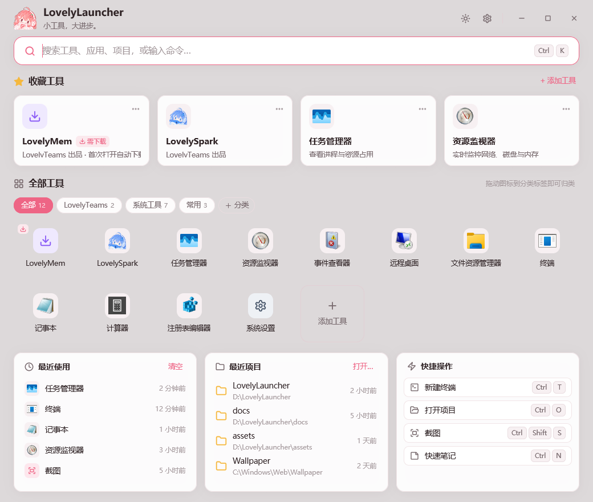
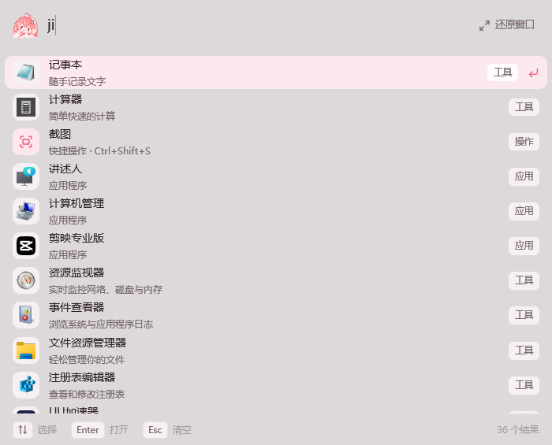
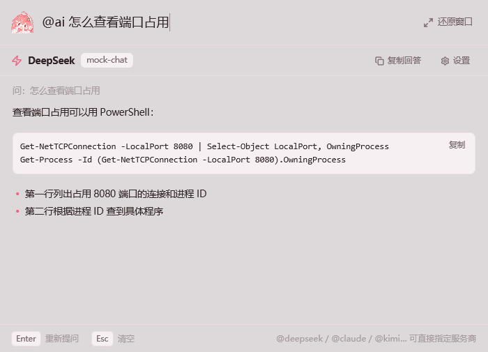
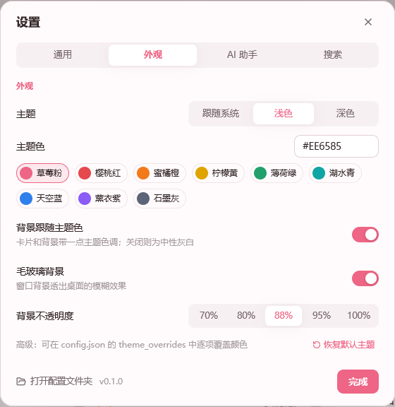
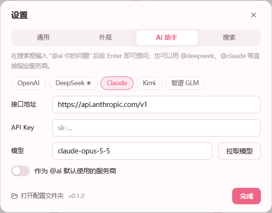
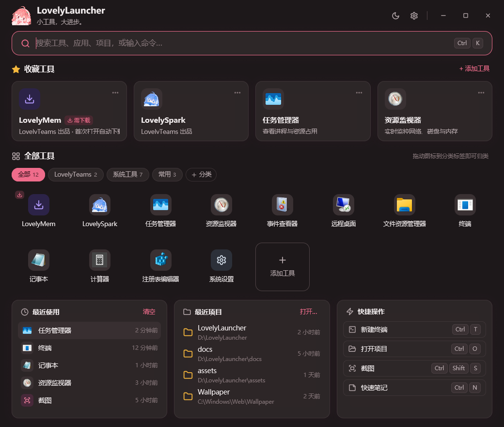

<div align="center">


# LovelyLauncher

**小工具，大进步。** 一个轻量、快捷的 Windows 工具启动器。

<p>
  
  
  
  
  
  
</p>

[功能亮点](#-功能亮点) · [截图](#-截图) · [快速开始](#-快速开始) · [使用指南](#-使用指南) · [AI 助手](#-ai-助手) · [配置](#%EF%B8%8F-配置文件) · [性能](#-性能)

<br />

<picture>
  <source media="(prefers-color-scheme: dark)" srcset="docs/images/dashboard-dark.png" />
  
</picture>

</div>

---

## ✨ 功能亮点

<table>
<tr>
<td width="50%" valign="top">

**⚡ 轻、快**
- 基于 [GPUI](https://gpui.rs)
- 单文件 exe 约 7 MB，upx压缩后不到 3M，常驻内存约 30 MB，**隐藏到托盘后不到 1 MB**

**🔍 一个输入框搞定一切**
- 工具、开始菜单应用、项目、快捷操作统一模糊搜索
- **拼音**全拼和首字母：`rwgl` → 任务管理器，`ji` → 记事本 / 计算器
- 接入 [Everything](https://www.voidtools.com/)，顺便搜文件
- `>命令` 直接执行，输入网址直接打开，其余一键网页搜索

</td>
<td width="50%" valign="top">

**🤖 `@ai` 随手问**
- `@ai 问题` 回车即问，答案流式显示，代码块一键复制
- 预置 OpenAI、DeepSeek、Claude、Kimi、智谱 GLM，模型列表直接从接口拉取

**🎀 好看，也好改**
- 收藏卡片 + 图标格子 + **自定义分类**（拖图标到分类标签即可归类）
- 每个工具都能**上传自定义图标**，默认用程序自带图标
- 主题色、背景色调、毛玻璃、不透明度都能调，还能逐项覆盖颜色

**🪟 用着顺手**
- `Alt+Space` 呼出**迷你搜索框**，一键还原完整窗口
- 托盘常驻、开机自启、单实例、高分屏 / 高缩放自适应

</td>
</tr>
</table>

## 📸 截图

<table>
<tr>
<td align="center" width="50%"><b>迷你搜索框</b>（<code>Alt+Space</code>，支持拼音）<br /><br /></td>
<td align="center" width="50%"><b><code>@ai</code> 快速提问</b><br /><br /></td>
</tr>
<tr>
<td align="center"><b>自定义主题</b><br /><br /></td>
<td align="center"><b>AI 服务商设置</b><br /><br /></td>
</tr>
</table>

<details>
<summary>深色主题</summary>
<br />

</details>

> 截图使用的是演示数据；`@ai` 截图里的回答来自本地模拟接口。

## 🚀 快速开始

### 构建

需要 [Rust](https://rustup.rs/)（MSVC 工具链）和 Visual Studio 的 **C++ 生成工具**。

```bash
cargo build --release
```

产物是单个文件 `target/release/LovelyLauncher.exe`，复制到任意位置即可运行。

### 发布新版本

仓库自带 GitHub Actions 工作流（[`.github/workflows/release.yml`](.github/workflows/release.yml)）：

1. 修改 `Cargo.toml` 里的 `version` 并提交；
2. 打标签并推送：`git tag v0.2.0 && git push origin v0.2.0`。

工作流会依次完成：检查标签和版本号是否一致 → 运行测试 → 编译 release 版 → **用 UPX 压缩**（`--best --lzma`）并校验 → 冒烟测试 → 打包 exe、zip 和 SHA256 校验文件 → 自动创建 GitHub Release，并生成更新说明。带连字符的标签（如 `v0.2.0-beta.1`）会发布为预发布版本。也可以在 Actions 页面手动运行，此时只编译并上传构建产物，不会创建 Release。

### 第一次使用

1. 运行后会出现主界面，同时在托盘里常驻。
2. 按 **`Alt+Space`** 随时呼出搜索框，再按一次隐藏。
3. 把常用的程序、脚本、文件夹**直接拖进窗口**，就成了工具和项目。
4. 想用 `@ai`：打开 **设置 → AI 助手**，填写 API Key，点“拉取模型”选一个。

> 如果 `Alt+Space` 被 PowerToys Run 等程序占用，可以在 **设置 → 通用** 里换成别的组合键。

## 📖 使用指南

### 搜索框能做什么

| 输入 | 效果 |
|---|---|
| `任务` / `rwgl` / `renwu` | 模糊搜索工具、应用、项目和快捷操作，支持拼音全拼和首字母 |
| `notes.md` | 同时显示 Everything 找到的文件和文件夹（需要 Everything 在运行） |
| `>ipconfig /all` | 在新的命令行窗口中执行命令 |
| `github.com` | 直接在浏览器打开网址 |
| `@ai 怎么查看端口占用` | 按 Enter 向默认 AI 服务商提问 |
| `@claude …` / `@deepseek …` | 指定服务商提问（`openai`、`deepseek`、`claude`、`kimi`、`glm`） |
| 其它任何内容 | 列表最后一项可以用网页搜索（默认必应，可在设置里更换） |

### 快捷键

| 按键 | 作用 |
|---|---|
| `Alt+Space` | 呼出 / 隐藏（默认弹出迷你搜索框） |
| `↑` `↓` · `Enter` | 选择 · 打开搜索结果；`@ai` 模式下为提问 |
| `Ctrl+Enter` | 以管理员身份运行 |
| `Esc` | 停止 AI 回答 → 清空搜索 → 隐藏窗口 |
| `Ctrl+K` | 聚焦搜索框 |
| `Ctrl+T` · `Ctrl+O` | 新建终端 · 打开项目 |
| `Ctrl+Shift+S` · `Ctrl+N` | 截图 · 快速笔记 |
| `Ctrl+D` · `Ctrl+,` | 添加工具 · 打开设置 |

### 工具、分类与图标

- **添加工具**：拖文件进窗口，或点“添加工具”，填写程序路径、网址，或者 `ms-settings:` 这类协议地址都可以。
- **分类**：点“＋ 分类”新建；**把图标拖到分类标签上**即可归类；右键分类可以重命名或删除。
- **图标**：编辑工具时点“上传图标…”，支持 PNG / JPG / ICO，也可以选一个 exe 提取它的图标；不上传就用程序自带的图标。
- **右键菜单**：打开、以管理员身份运行、收藏、编辑、打开文件位置、删除。
- **预设下载**：LovelyMem、LovelySpark 第一次点开时会自动下载（卡片上显示进度），下载完自动启动；右键可以重新下载来更新。

### 迷你搜索框

热键默认弹出一个只有输入框的小窗口，出现在鼠标所在显示器的偏上位置。打字后在下方展开结果，点“还原窗口”会回到完整界面，并恢复原来的位置和大小。点到别处时它会自动收起。不喜欢的话可以在 **设置 → 通用** 里关掉，热键就会直接打开完整窗口。

## 🤖 AI 助手

在 **设置 → AI 助手** 里为每家服务商填写接口地址、API Key 和模型。点“拉取模型”会请求服务商的 `/models` 接口，列出可用模型供你点选；也可以直接手动填写模型名。

| 服务商 | 默认接口地址 | 接口格式 |
|---|---|---|
| OpenAI | `https://api.openai.com/v1` | Chat Completions |
| DeepSeek | `https://api.deepseek.com/v1` | OpenAI 兼容 |
| Claude | `https://api.anthropic.com/v1` | Anthropic Messages（默认模型 `claude-opus-5-5`） |
| Kimi | `https://api.moonshot.cn/v1` | OpenAI 兼容 |
| 智谱 GLM | `https://open.bigmodel.cn/api/paas/v4` | OpenAI 兼容 |

- 回答以流式方式实时显示，支持标题、列表和代码块（代码块带“复制”按钮），`Esc` 可随时停止。
- 接口地址可以改成任何 OpenAI 兼容的服务，比如中转站或本地模型。
- ⚠️ API Key 以**明文**保存在本机的 `config.json` 里，请不要把这个文件分享给别人。

## 🎨 主题

在 **设置 → 外观** 中可以调整：

- 主题模式：跟随系统 / 浅色 / 深色（标题栏的 ☀️ 按钮也能快速切换）
- 主题色：9 个预设，或输入任意 `#RRGGBB`，**实时生效**
- 背景跟随主题色、毛玻璃背景、背景不透明度（70% ~ 100%）

所有颜色都由主题色推导出来。想进一步微调的话，可以在 `config.json` 里按浅色 / 深色分别覆盖任意颜色项：

```jsonc
"theme_overrides": {
  "light": { "window_bg": "#FFF4F7", "accent": "#FF5C8A" },
  "dark":  { "panel": "#2A2030" }
}
```

<details>
<summary>可覆盖的颜色项</summary>

`window_bg` `panel` `panel_hover` `surface` `border` `border_strong` `text` `text_muted` `text_faint` `accent` `accent_soft` `accent_text` `input_bg` `selection` `kbd_bg` `kbd_border` `row_hover` `row_active` `overlay` `danger` `banner_bg` `banner_text` `folder`

</details>

## ⚙️ 配置文件

- 默认位置：`%APPDATA%\LovelyLauncher\config.json`（设置页左下角“打开配置文件夹”可以直接打开）
- 设置环境变量 **`LOVELYLAUNCHER_DATA`** 可以把数据放到别的目录，适合便携使用
- 自定义图标保存在数据目录的 `icons\` 下；预设程序下载到 `%LOCALAPPDATA%\LovelyLauncher\apps\`
- 配置文件可以手动编辑（带不带 BOM 都行）；旧版本的配置会自动迁移

## 📊 性能

在 Windows 11、2560×1440 显示器上实测 release 版：

| 指标 | 数值 |
|---|---|
| 程序体积 | **7.4 MB**（单文件，无需运行时） |
| 窗口显示时内存（私有工作集） | **约 30 MB** |
| 隐藏到托盘后内存 | **< 1 MB**（隐藏 3 秒后把内存交还给系统） |

> “提交大小”约 100 MB，主要是显卡驱动和 Direct3D 的地址空间预留，并不占用物理内存。

## 🗂️ 项目结构

| 文件 | 职责 |
|---|---|
| `src/main.rs` | 启动、单实例、窗口创建、事件分发 |
| `src/launcher.rs` | 核心状态与逻辑：搜索、启动、下载、分类、迷你模式、AI 会话 |
| `src/view.rs` | 主界面渲染：仪表盘、图标格子、搜索结果、迷你框、AI 面板 |
| `src/dialogs.rs` | 编辑工具、设置（通用 / 外观 / AI / 搜索）、分类对话框 |
| `src/input.rs` | 支持输入法（IME）的单行输入框 |
| `src/search.rs` | 模糊匹配与拼音搜索 |
| `src/ai.rs` · `src/http.rs` | AI 接口（OpenAI 兼容 / Anthropic）与 WinHTTP 客户端 |
| `src/everything.rs` | Everything IPC 文件搜索 |
| `src/win.rs` | Win32：窗口、图标提取、开始菜单扫描、开机自启 |
| `src/theme.rs` · `src/config.rs` | 主题生成、配置与迁移 |
| `build.rs` | 从 `assets/icon.png` 生成 exe 图标、托盘图标和应用内 Logo |

想换应用图标的话，替换 `assets/icon.png` 再重新编译即可。

## 🙏 致谢

- [GPUI](https://gpui.rs) — Zed 团队开源的 GPU 加速 UI 框架
- [Everything](https://www.voidtools.com/) — voidtools 的极速文件搜索
- 界面线条图标的路径参考了 [Lucide](https://lucide.dev)（ISC 许可）

<div align="center">
<br />
<sub>Made with 💗</sub>
</div>
